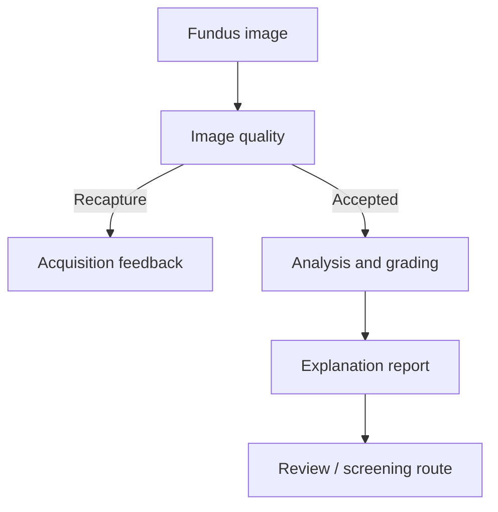

# NetrAI

**Explainable diabetic retinopathy screening for rural care settings**

SIH 2026 · Problem Statement SIH26038 · Team Biscuit · MathWorks-sponsored challenge

NetrAI combines a MATLAB screening pipeline with a SimEvents model of district
screening capacity. The prototype helps an operator assess image quality, produces
severity and referral outputs, and generates an annotated report for review.
The simulation explores how connectivity, staffing and recapture demand affect
screening completion.

<!-- current-state:start -->
> **Current state (2026-10-13):** the deployed MATLAB model is unchanged. The 768-pixel research
> models refer far more referable eyes than the deployed model on cameras they never saw:
> **90.5% / 84.5%** (sensitivity / specificity) on ODIR-5K (round 3; AUC 0.948 vs 0.885 deployed)
> and **78.0% / 92.4%** on the new Moroccan FDR26 set (round 4), where the deployed model reaches
> 50.3% / 99.7%. On FDR26, ranking (AUC 0.910) is no better than the deployed model's (0.911):
> moderate (grade-2) eyes and some camera formats are the main weaknesses. No candidate meets
> both targets, so they remain opt-in research variants. See [validation](docs/VALIDATION.md).
<!-- current-state:end -->

[Run the prototype](matlab/README_MATLAB.md) · [Validation evidence](docs/VALIDATION.md) · [Demo guide](docs/DEMO.md) · [Model card](docs/MODEL_CARD.md)

## Screening workflow



| Component | Implemented capability |
| --- | --- |
| Image quality | Focus, illumination and field-of-view checks with recapture feedback |
| Retinal analysis | Optic-disc/fovea localization, vessels and lesion candidate overlays |
| DR grading | Trained EfficientNet-B4 ONNX inference with five-grade and referral output heads |
| Explanation report | Referral-targeted Grad-CAM, evidence checklist and PDF report |
| District simulation | SimEvents acquisition, bounded recapture returns, upload, processing and review queues |

The grade and referral heads share a backbone. Disagreeing outputs route to
human review. The capacity simulation is a separate planning model.

## Prototype and results

All five component categories are implemented. Validation is ongoing; NetrAI is
a research prototype and has not been clinically validated.

| Evaluation | Recorded result | Interpretation |
| --- | --- | --- |
| MATLAB model execution | 733/733 images processed; zero processing errors | September 28 internal development run |
| Internal referable-DR grading | Sensitivity 94.63%, specificity 94.02%, QWK 0.9330 | Training overlap affects this cohort; not independent accuracy evidence |
| Model runtime comparison | 733/733 grades and screening routes match; maximum probability difference 2.82 × 10⁻⁶ | Passes the fixed model-mode gates; not full-image or clinical validation |
| Model-mode execution time | Mean 2.33 s/image on CPU | Includes byte verification/decoding, quality assessment and grading; excludes retinal analysis, Grad-CAM, report generation and review |
| SimEvents workflow verification | 18 annual conservation checks; 7 independent deterministic fixture comparisons; 3 native seeded runs | Engineering verification under declared assumptions; no field calibration |

The internal cohort includes **35 images with exact-content counterparts in
training** and informed model/policy selection. External-domain development
results remain below screening acceptance targets. See the
[validation report](docs/VALIDATION.md) for sample sizes, artifact links and open gates.

The MATLAB preprocessing repair reproduces the released model input contract.
Model weights, calibration and routing policy are unchanged; agreement with the
reference runtime closes a numerical defect rather than establishing new accuracy.

The endpoint-v3 simulation now returns rejected patients to the shared acquisition
queue, with at most two recaptures. Under the one-reviewer, 10% rejection,
zero-dropout assumptions, simulated completion was 32.14% at 0.25 Mbps and 99.89%
at 1 Mbps. The slow link creates an upload backlog; an additional reviewer does
not remove it. These outcomes assume a 56 Mb patient upload and 30-second review;
they describe model behavior rather than observed field impact.
[Workflow evidence](results/benchmarks/matlab_workflow_2026-09-28/workflow_evidence_summary.json)

## Run in MATLAB

The tested environment is **MATLAB R2026a Update 5**. Image inference requires
Deep Learning Toolbox, Image Processing Toolbox and the Deep Learning Toolbox
Converter for ONNX Model Format support package. M5 also requires Simulink and
SimEvents. No local GPU is required.

Clone the repository, open its `matlab` folder, and enter these commands in the
**MATLAB Command Window**:

```matlab
fixtureReport = verifyMatlabPackage();
result = demo_netrai("/absolute/path/to/fundus.png");
```

Supply a local image whose terms permit your intended use. Images and datasets
are not bundled. Accepted images produce a report; rejected images produce
recapture feedback. Each demo run uses a new output directory.

Deployment checks bind the model, configuration and inference code by SHA-256,
including the callable source bytes selected by MATLAB's current path.
MATLAB validation records the complete selected cohort and evaluated image
content before inference. New schema-3 chunks also freeze the decision policy;
merging checks calibration and threshold-derived decisions and rejects missing
cases, incompatible artifacts and invalid predictions. Validation outputs use
new directories so earlier evidence is preserved.

To inspect the capacity model:

```matlab
open_system('models/NetrAI_Telemedicine_Model.slx')
```

See [MATLAB setup and batch validation](matlab/README_MATLAB.md) for detailed instructions.

On Linux, you can launch the demonstration from a **terminal** at the repository root:

```bash
./scripts/launch_demo.sh /absolute/path/to/fundus.png
```

The launcher opens MATLAB, runs the image demonstration and opens the SimEvents
model. MATLAB expressions such as `result = demo_netrai(...)` belong in MATLAB's
Command Window; they cannot be entered directly into Bash.

## Scope and next steps

Lesion overlays are candidate detections, and Grad-CAM visualizes model
attribution. Neither is proof of a confirmed lesion. External screening accuracy is
the main open problem: a round-2 candidate is far more sensitive on unseen cameras
(93.9% on Messidor-2) but its specificity there is 69.3%, because decision thresholds
do not transfer between cameras; per-camera calibration is still needed. Portable-camera robustness,
fresh external grading, broader full-image runtime checks and clinician explanation/review-time
studies remain open. The capacity model's next steps are field-derived return and
service assumptions, shift calendars, outages and timed referral escalation.

## Repository guide

- [`matlab/`](matlab/README_MATLAB.md): primary screening implementation, deployment artifacts and SimEvents model.
- [`docs/`](docs/VALIDATION.md): validation, model documentation and demonstration instructions.
- [`results/`](results/README.md): organized benchmark evidence with dates, runtime and limitations.
- [`data/README.md`](data/README.md): dataset sources, layout and usage terms.
- [`research/`](research/README.md): model-training provenance.

## License and contributions

Original project source and documentation use the [MIT License](LICENSE).
Models, datasets, image fixtures and third-party components retain separate
terms; see [licensing scope](LICENSE_STATUS.md).
Contributions should include reproducible evidence and respect these boundaries.
See [CONTRIBUTING.md](CONTRIBUTING.md).
