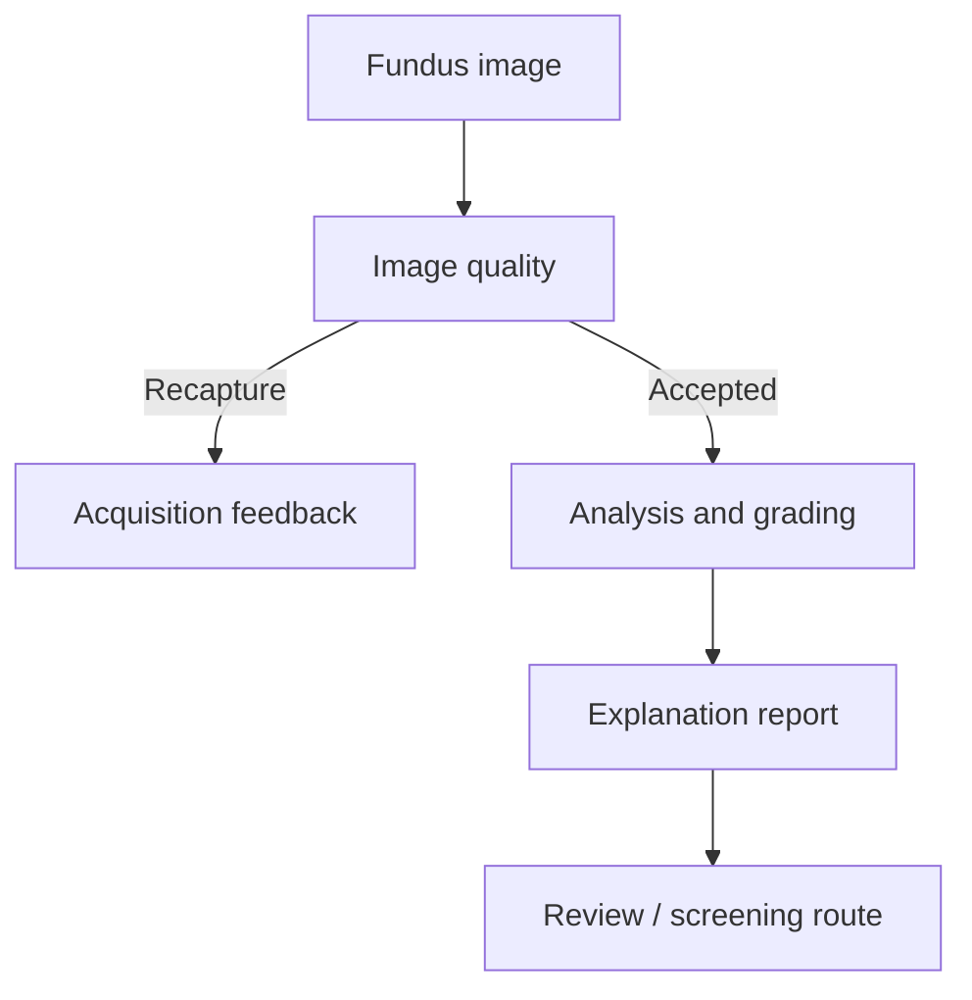

# NetrAI

**Explainable diabetic retinopathy screening for rural care settings**

SIH 2026 · Problem Statement SIH26038 · Team Biscuit · MathWorks-sponsored challenge

NetrAI combines a MATLAB screening pipeline with a SimEvents model of district
screening capacity. The prototype helps an operator assess image quality, produces
severity and referral outputs, and generates an annotated report for review.
The simulation explores how connectivity, staffing and recapture demand affect
screening completion.

<!-- current-state:start -->
> **Current state (2026-11-17):** the presented screening model is **E_768 with a per-site calibration of its referral cut-off** (weights: a hash-checked
> download from the project's `e768-v1` release; without them the checkout runs the legacy model; MATLAB and Python both support it). On the four newest
> fresh external tests E_768 ranks referable DR better than or comparably to the legacy model (AUC 0.948–0.998); its frozen cut-off met the 90% / 85% targets on two
> easier sets (Paraguay, Zeiss: 96.7% / 96.8%; SUSTech-SYSU, Topcon: 99.4% / 95.6%) but not on screening-population sets (mBRSET smartphone 89.2% / 89.3%;
> BRSET Canon images over-referred). Site calibration with a 95% target, confirmed on a fresh test, keeps sensitivity near 0.94 but cannot fix
> cameras on which the model ranks poorly; fitting it and checking it on a separate sample runs in MATLAB or Python from the released weights. On a fresh any-DR test (RFMiD 2.0) legacy ranks DR better (AUC 0.84 vs 0.76).
> Images that do not look like fundus photographs carry a visible warning (99.3% of non-fundus test images flagged; a warning rather than a rejection
> because about 1% of smartphone retinas would be turned back). Python and MATLAB reach the same decisions on 68 test images from 13 datasets, and their Grad-CAM maps match on the
> fixture images both test suites check. Re-encoding images to shrink uploads changes some referral decisions (no tested setting met the
> 1% bar), so images should be sent as the camera saved them. New on November 17: a screening console for live demonstrations (`netraiApp`), and the full
> MATLAB report now takes 14–21 s per image with E_768 (19–34 s before) because grading and the attention map share one network pass, with identical outputs. Details and limits:
> [validation](docs/VALIDATION.md) · [evidence card](docs/EVIDENCE_CARD.md).
<!-- current-state:end -->

[Run the prototype](matlab/README_MATLAB.md) · [Evidence card](docs/EVIDENCE_CARD.md) · [Validation evidence](docs/VALIDATION.md) · [Demo guide](docs/DEMO.md) · [Model card](docs/MODEL_CARD.md)

## Against the problem-statement targets

| Target | Where NetrAI stands | Evidence |
| --- | --- | --- |
| Referable-DR sensitivity above 90% and specificity above 85% | Met at the model's fixed cut-off on two fresh external tests: 96.7% / 96.8% (Paraguay, Zeiss camera) and 99.4% / 95.6% (SUSTech-SYSU, Topcon camera); both sets are easier than a screening population. Close on two harder fresh tests: 89.2% / 89.3% on smartphone images (mBRSET) and 90.5% / 84.5% on ODIR-5K. Not met on desktop-camera images from Brazil (BRSET) at the fixed cut-off: 98.5% / 56.0%, because it over-refers on Canon images; calibrating the cut-off for the site brings Canon specificity to about 83% at about 94% sensitivity (post hoc analysis). | Each test was locked and scored once: [evidence card](docs/EVIDENCE_CARD.md), claims 2 and 9–12 |
| Five-grade agreement (QWK above 0.85) | 0.933 on the internal development set, which overlaps training. On unseen cameras mild DR is rarely recognised, so no five-grade claim is made; the referral decision is the supported output. | [Validation](docs/VALIDATION.md) |
| A result in under 30 seconds | Yes on the laptop CPU tested: the full MATLAB report (quality check, grading, attention map, retinal analysis, PDF) took 14–21 s per image with E_768 and 8–16 s with the legacy model on three images of 0.3–12 megapixels (November 17, after grading and the attention map began sharing one network pass; 19–34 s before on the same images). The one-time model load of up to two minutes is not included. | [Timing runs](results/benchmarks/matlab_runtime_2026-11-17/shared_forward_pass_timing.json) |
| An explanation a clinician can check | The attention map (Grad-CAM of the referral output) puts 3.0 to 6.1 times the chance level of its energy on annotated lesions (two annotated sets) and its strongest point on a lesion in 86–89% of images. It shows model evidence, not lesion outlines. | [Evidence card](docs/EVIDENCE_CARD.md), claim 6 |
| Fit for a rural workflow | Image-quality check with recapture advice, a warning for inputs that are not fundus photographs, per-site calibration tools, and a SimEvents model of a district's yearly screening load under different links and staffing. | [Demo guide](docs/DEMO.md) |

These are research results on public datasets. NetrAI has not been clinically validated.

## Screening workflow



| Component | Implemented capability |
| --- | --- |
| Image quality | Focus, illumination and field-of-view checks with recapture feedback; inputs that do not look like a fundus photograph get a visible warning |
| Retinal analysis | Optic-disc/fovea localization, vessels and lesion candidate overlays |
| DR grading | Trained EfficientNet-B4 ONNX inference with five-grade and referral output heads |
| Explanation report | Referral-targeted Grad-CAM, evidence checklist and PDF report |
| District simulation | SimEvents acquisition, bounded recapture returns, upload, processing and review queues |
| Screening console | `netraiApp`: one window for a live run, showing the routing decision, attention map, candidate marks, warnings and capacity scenarios |

The grade and referral heads share a backbone. Disagreeing outputs route to
human review. The capacity simulation is a separate planning model.

## Prototype and results

All five component categories are implemented. Validation is ongoing; NetrAI is
a research prototype and has not been clinically validated.

| Evaluation | Recorded result | Interpretation |
| --- | --- | --- |
| MATLAB model execution | 733/733 images processed; zero processing errors | September 28 internal development run |
| Internal referable-DR grading | Sensitivity 94.63%, specificity 94.02%, QWK 0.9330 | Training overlap affects this cohort; not independent accuracy evidence |
| Model runtime comparison | 733/733 grades and screening routes match; maximum probability difference 2.82 × 10⁻⁶ | Passes the fixed model-mode gates; not full-image or clinical validation |
| Execution time on a laptop CPU | Legacy model mode: mean 2.33 s/image (733 images). On 18 images (Oct 30), both measured identically: legacy 1.3 s, E_768 4.8 s; full report with retinal analysis and Grad-CAM 14–21 s/image for E_768, 8–16 s for legacy (3 images of 0.3–12 megapixels, Nov 17; [timing](results/benchmarks/matlab_runtime_2026-11-17/shared_forward_pass_timing.json)) | Model mode: decoding, quality assessment and grading; the one-time model import (about 2 min for E_768) is excluded; Intel i5-10210U |
| Non-fundus input guard | 99.3% of 2,579 non-fundus sample images flagged; real retinas flagged in ≤ 0.12% of gradable images on six unseen sets, 1.13% on a smartphone set | Exposed data (TX); ships as a warning, not a rejection |
| Upload recompression | No tested setting kept E_768 referral changes within the 1% bar set before scoring (JPEG 75: 4 of 300 changed, all next to the cut-off; downscaling changed up to 28) | Exposed data (TX); send images as the camera saved them |
| SimEvents workflow verification | 18 annual conservation checks; 7 independent deterministic fixture comparisons; 3 native seeded runs | Engineering verification under declared assumptions; no field calibration |

The internal cohort includes **35 images with exact-content counterparts in
training** and informed model/policy selection. External-domain development
results remain below screening acceptance targets. See the
[validation report](docs/VALIDATION.md) for sample sizes, artifact links and open gates.

The MATLAB preprocessing repair reproduces the released model input contract.
Model weights, calibration and routing policy are unchanged; agreement with the
reference runtime closes a numerical defect rather than establishing new accuracy.

The endpoint-v3 simulation now returns rejected patients to the shared acquisition
queue, with at most two recaptures. Under the one-reviewer, 10% rejection,
zero-dropout assumptions, simulated completion was 32.14% at 0.25 Mbps and 99.89%
at 1 Mbps. The slow link creates an upload backlog; an additional reviewer does
not remove it. These outcomes assume a 56 Mb patient upload and 30-second review;
they describe model behavior rather than observed field impact.
[Workflow evidence](results/benchmarks/matlab_workflow_2026-09-28/workflow_evidence_summary.json)

## Run in MATLAB

The tested environment is **MATLAB R2026a Update 5**. Image inference requires
Deep Learning Toolbox, Image Processing Toolbox and the Deep Learning Toolbox
Converter for ONNX Model Format support package. M5 also requires Simulink and
SimEvents. No local GPU is required.

Clone the repository, open its `matlab` folder, and enter these commands in the
**MATLAB Command Window**:

```matlab
fixtureReport = verifyMatlabPackage();
result = demo_netrai("/absolute/path/to/fundus.png");
```

For a live demonstration in one window, run `netraiApp` instead (see the [demo guide](docs/DEMO.md)).

Supply a local image whose terms permit your intended use. Images and datasets
are not bundled. Accepted images produce a report; rejected images produce
recapture feedback. Each demo run uses a new output directory.

Deployment checks bind the model, configuration and inference code by SHA-256,
including the callable source bytes selected by MATLAB's current path.
MATLAB validation records the complete selected cohort and evaluated image
content before inference. New schema-3 chunks also freeze the decision policy;
merging checks calibration and threshold-derived decisions and rejects missing
cases, incompatible artifacts and invalid predictions. Validation outputs use
new directories so earlier evidence is preserved.

To inspect the capacity model:

```matlab
open_system('models/NetrAI_Telemedicine_Model.slx')
```

See [MATLAB setup and batch validation](matlab/README_MATLAB.md) for detailed instructions.

On Linux, you can launch the demonstration from a **terminal** at the repository root:

```bash
./scripts/launch_demo.sh /absolute/path/to/fundus.png
```

The launcher opens MATLAB, runs the image demonstration and opens the SimEvents
model. MATLAB expressions such as `result = demo_netrai(...)` belong in MATLAB's
Command Window; they cannot be entered directly into Bash.

## Scope and next steps

Lesion overlays are candidate detections, and Grad-CAM visualizes model
attribution. Neither is proof of a confirmed lesion. External screening accuracy is
the main open problem: a round-2 candidate is far more sensitive on unseen cameras
(93.9% on Messidor-2) but its specificity there is 69.3%, because decision thresholds
do not transfer between cameras; per-camera calibration is still needed. Portable-camera robustness,
fresh external grading, broader full-image runtime checks and clinician explanation/review-time
studies remain open. The capacity model's next steps are field-derived return and
service assumptions, shift calendars, outages and timed referral escalation.

## Repository guide

- [`matlab/`](matlab/README_MATLAB.md): primary screening implementation, deployment artifacts and SimEvents model.
- [`docs/`](docs/VALIDATION.md): validation, model documentation and demonstration instructions.
- [`results/`](results/README.md): organized benchmark evidence with dates, runtime and limitations.
- [`data/README.md`](data/README.md): dataset sources, layout and usage terms.
- [`research/`](research/README.md): model-training provenance.

## License and contributions

Original project source and documentation use the [MIT License](LICENSE).
Models, datasets, image fixtures and third-party components retain separate
terms; see [licensing scope](LICENSE_STATUS.md).
Contributions should include reproducible evidence and respect these boundaries.
See [CONTRIBUTING.md](CONTRIBUTING.md).
